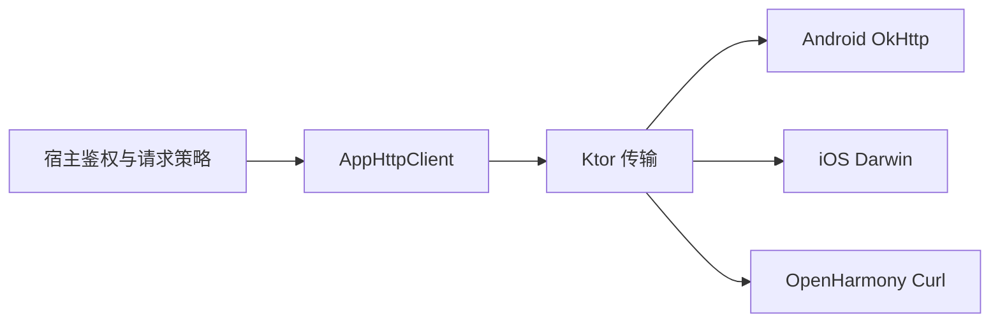
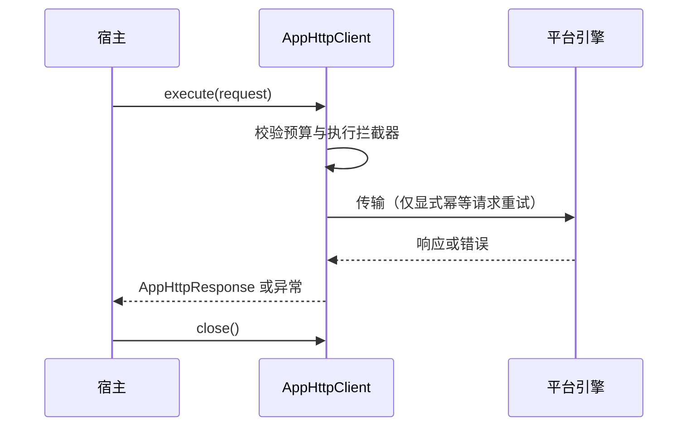
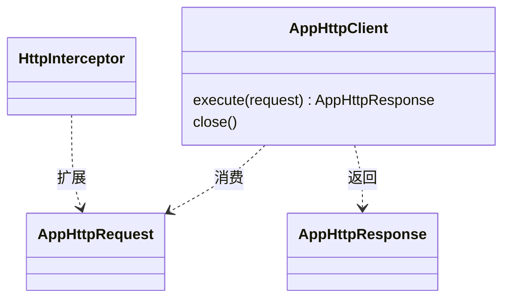

# HTTP

提供 Android、iOS、OpenHarmony 共用的 HTTP 契约、Ktor 传输、平台引擎、上传及失败分类。`http-core` 不提供 UI 或 Kuikly Module；业务 URL、品牌、登录凭据、隐私同意、日志脱敏与请求策略由宿主负责。

当前为 **1.0.0 首个正式版本（待发布）**，不能视为已可从 JitPack 下载。平台合同见[功能与平台差异](docs/功能与平台差异.md)，构建、测试和发布入口见[开发与验证](docs/开发与验证.md)。

## 架构与调用流程



宿主安装拦截器并持有 Client；组件负责传输和错误映射，取消随调用协程传播。



[`AppHttpClient`](http-core/src/commonMain/kotlin/com/dgtang/live/data/remote/AppHttpClient.kt) 是业务契约；[`createHttpClient`](http-core/src/commonMain/kotlin/com/dgtang/live/data/remote/HttpClientFactory.kt) 与 [`httpTransport`](http-core/src/commonMain/kotlin/com/dgtang/live/data/remote/KtorHttpTransport.kt) 用于宿主装配。



## 安装与最小使用

发布完成后的预期坐标（当前未发布）：

```kotlin
repositories { maven("https://jitpack.io") }
commonMain.dependencies {
    implementation("com.github.gycrosskit.http:http-core:1.0.0")
}
```

保持宿主基线：Kotlin `2.2.21-1.0.0`、AGP `8.10.1`、Gradle `8.11.1`、Ktor `3.3.3-1.1.0-04`、coroutines `1.10.2-1.0.0`、serialization `1.9.1-1.0.0`。Android compileSdk 36 / minSdk 24 / JVM 11；iOS 生成 arm64、Simulator arm64/x64 KLIB，最低系统版本仍须随实际 Native 产物与宿主核验；OHOS 为 `ohosArm64`。无单独 SPM、Pod、HAR 或 ohpm 包。

Android 平台装配示例；iOS/OHOS 分别替换为 `createIosHttpClientEngine()` / `createOhosHttpClientEngine()`：

```kotlin
import com.dgtang.live.data.remote.*

val client = createHttpClient(createAndroidHttpClientEngine()).httpTransport(
    baseUrl = { "https://api.example.test" },
    interceptors = listOf(/* 宿主鉴权、隐私与日志策略 */),
)
try {
    val response = client.get("/catalog") {
        parameter("page", 1)
        enableIdempotentRetry(1) // 仅在服务端确认幂等时启用
    }
    check(response.status == 200)
} finally {
    client.close() // 由持有该 Client 的宿主 owner 收尾
}
```

`expectSuccess=false`，HTTP 非 2xx 仍返回响应；不要把请求受理或网络成功当作业务成功。超时映射为 `HttpTransportException(TIMEOUT)`，外部取消继续抛出 `CancellationException`。默认零重试；显式重试只覆盖网络异常、超时与 5xx，不用于提交、支付、领取等非幂等请求。

公开工厂/扩展签名包含 Ktor 类型，因此 `ktor-client-core` 作为 `api` 依赖传递。Ktor 插件和各端引擎实现保留内部依赖。包名保持 `com.dgtang.live.data.remote`，便于宿主保持现有调用。

## 验证与反馈

保留传输、超时、取消、JSON、上传及宿主 hook 的通用回归，并补默认/显式重试边界回归。独立 `verification-consumer` 不直接声明 Ktor、coroutines、serialization 主依赖，检验公开 API 的产物传递依赖。**1.0.0 尚待重新打包与实际 binary consumer 验证，公开坐标消费和设备验收未完成**；轻量脚本检查不能代替这些证据。

发行入口：[Releases](https://github.com/gycrosskit/http/releases)（1.0.0 待发布）。问题反馈请通过 [Issues](https://github.com/gycrosskit/http/issues) 提供脱敏输入、平台、精确版本及异常原因；不要上传凭据或用户正文。源码抽离自宿主 `c768cb12c86e59b60fbc69149013850edce509b0`，许可证为 [Apache-2.0](LICENSE)。
